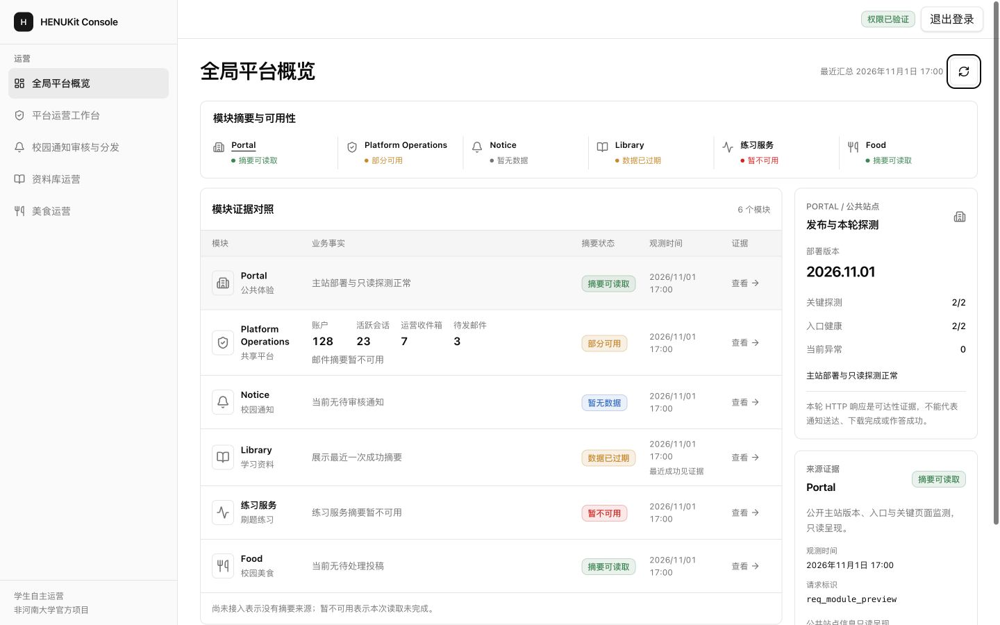
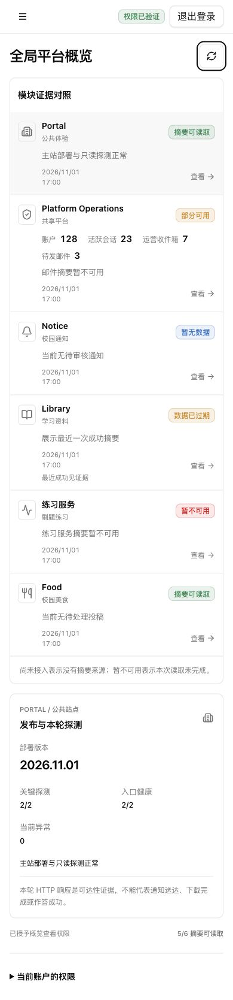

# Console 全局证据总览：视觉审查材料

这两张图是 **2026-11-02 已批准布局的受控虚构数据截图**，用于说明桌面与手机的结构和状态覆盖。不是生产数据、不是2026-11-06新拍截图，也不是新发布SHA的线上验收回执。

- 桌面1440px：六模块对照、独立Portal探测、选中模块来源。
- 手机390px：保留完整六模块，来源证据可在同一对象下展开。
- 图中账户/指标/时间/请求标识均为本机fixture；没有Cookie、Token、真实用户身份或生产配置。

本次发布保留既定运行UI，另维护与新结构对应的浏览器测试。正式上线结果仍需独立核对新main SHA、构件来源、激活回执、静态资源和真实会话下的页面；这些旧图不替代该验收。
